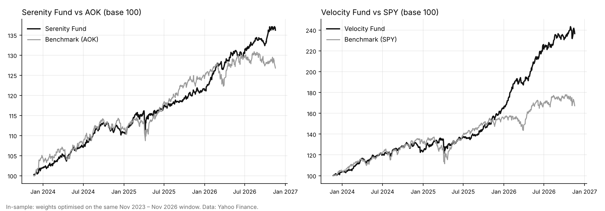

# Serenity & Velocity — Multi-Asset Portfolio Construction in Python

Two multi-asset funds built end to end in Python, from asset selection to risk reporting: a **defensive fund (Serenity)** and a **growth fund (Velocity)**. Both are optimised for the maximum Sharpe ratio under fund-specific constraints, benchmarked, stress-tested with Value-at-Risk and published as an interactive HTML dashboard.

> Group project — *Financial Risk Management*, M2 Corporate Finance & Investment Banking, NEOMA Business School (2026).
> Authors: **Clément Bertin** and **Matthieu Billon**.



## Results

Sample: 20 Nov 2023 – 17 Nov 2026 (3 years of daily data, Yahoo Finance). Risk-free rate: 4.1 % (13-week T-bill, ^IRX).

| | **Serenity** (defensive) | **Velocity** (growth) |
|---|---|---|
| Benchmark | AOK (≈ 30 % equity / 70 % bonds) | SPY (S&P 500) |
| Annualised return | 10.5 % | 29.6 % |
| Annualised volatility | 4.4 % | 11.2 % |
| Sharpe ratio | **1.45** (benchmark 0.65) | **2.28** (benchmark 0.92) |
| Maximum drawdown | −4.1 % | −10.6 % |
| Beta / alpha vs benchmark | 0.37 / +4.9 % | 0.45 / +18.9 % |
| Equity share | 35 % | 83 % |
| 10-day 99 % historical VaR on $1bn | $15.4m | $56.2m |

These figures are **in-sample**: the weights were optimised on the same three years they are measured on. See [Limitations](#limitations).

## Methodology

**1. Asset selection** (`scripts/selectors/`)
One selector per asset class: stocks, ETFs, bonds, commodities and crypto. Each downloads three years of prices and ranks assets with z-scores:
- momentum, P(t−21) / P(t−273) − 1;
- volatility and beta to the S&P 500 over 252 trading days;
- yield and empirical duration for bonds.

Highly correlated assets are then removed.

**2. Fund composition** (`compose_funds.py`)
The best assets of each class are picked by quota, giving 25 assets per fund:
- Serenity: 9 bonds, 8 equities, 5 ETFs, 3 real assets;
- Velocity: 13 equities, 7 ETFs, 2 real assets, 2 bonds, 1 crypto.

A cross-class correlation filter (threshold 0.85) is applied again before optimisation.

**3. Optimisation** (`fundlib.py`)
Long-only Markowitz optimisation that maximises the Sharpe ratio (SciPy SLSQP), under these constraints:

| Constraint | Serenity | Velocity |
|---|---|---|
| Weight per line | 1 % – 10 % | 1 % – 12 % |
| Equity share | ≤ 35 % | ≥ 70 % |
| Return target | — | ≥ risk-free + 6 pts |

The efficient frontier is plotted for comparison.

**4. Risk analytics**
- Beta, alpha, R², tracking error, information ratio and Treynor ratio against each fund's benchmark.
- 10-day 99 % VaR and Expected Shortfall on a $1bn portfolio, both historical and parametric. The historical VaR is backtested on 741 rolling windows.

**5. Reporting**
An HTML dashboard with one page per fund:
- z-score heatmaps;
- base-100 performance and drawdown;
- daily returns;
- Markowitz frontier and final allocation;
- beta / alpha;
- VaR;
- the latest news on the three largest holdings;
- a volatility gauge.

## Run it

Requires Python 3 (developed with Python 3.12).

```bash
pip install -r requirements.txt
python scripts/run_all.py              # builds both funds (≈ 2–3 min)
python scripts/run_all.py --refresh    # forces a fresh Yahoo Finance download
```

Then open `index.html` in a browser. To build a single fund, run `python scripts/1/serenity.py` or `python scripts/2/velocity.py`.

To rebuild the universes from scratch, run the five `selector_*.py` scripts, then `compose_funds.py` (all in `scripts/selectors/`). The selections used here come from a run on 16 Nov 2026.

## Project structure

| Path | Role |
|---|---|
| `scripts/selectors/` | Per-class selectors, their outputs (`selection_*.csv`) and `compose_funds.py` |
| `scripts/universe_*.json` | The 25 assets and the rules of each fund |
| `scripts/config.py` | Benchmarks, constraints and loading of the universes |
| `scripts/fundlib.py` | Engine: data, z-scores, optimisation, risk metrics, charts and HTML pages |
| `scripts/run_all.py` | Builds both funds |
| `scripts/data/` | Cached prices, z-scores, fund summaries (JSON) and news |
| `index.html`, `1.html`, `2.html`, `analytics/` | Dashboard |

## Limitations

- **In-sample results.** Expected returns are three-year historical means, and the optimiser is evaluated on the same window. This favours assets that performed best in the past (selection bias), so the Sharpe ratios above overstate what to expect out of sample.
- **Cash-like ETFs lift Serenity's Sharpe.** SGOV and BIL are near-riskless, so they raise the ratio mechanically.
- **Velocity is more defensive than its name.** The optimiser favours low-volatility stocks (KO, JNJ, CB) and a few strong performers (TRGP, MU), which explains its low beta (0.45) despite an 83 % equity share.
- **Next steps:** out-of-sample testing with a rolling window, periodic rebalancing with transaction costs, and shrinkage of expected returns.

*Academic project — not investment advice.*
